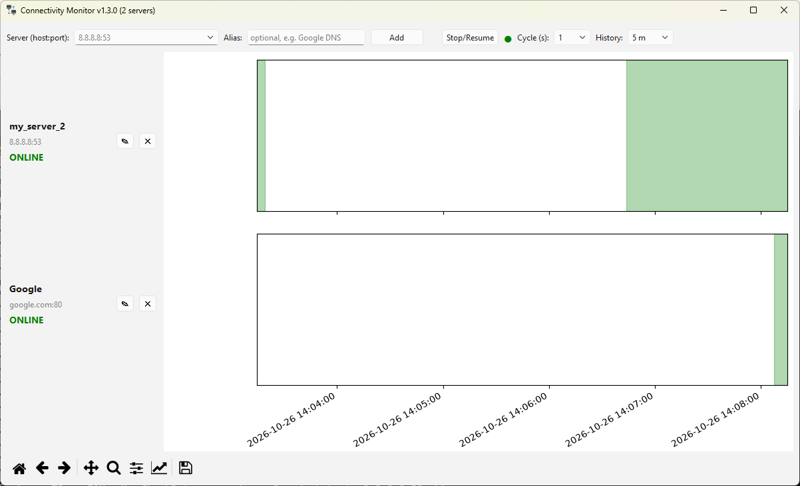

# pyConnectionMonitor
Simple python application that checks network connectivity to another computer:port.

## Highlights:
- the app is able to provide any computer host and port, or use the default 8.8.8.8:53 to check for internet connectivity
- the app shows a graph to easily see the connection status over time
- you can select the cycle time, default 1 second
- you can select the plot history size, default 1 minute
- you can pause/ resume the check at any time
- the check status is saved on disk so you will not lose past connection status data when the app is closed

# GUI layout

# Support
Found this project useful? Send your ❤ in any form you can 🙂. Please contact me if you donated and want to be added to the contributors list !

- chia XCH---xch1glz7ufrfw9xfp5rnlxxh9mt9vk9yc8yjseet5c6u0mmykq8cpseqna6494
